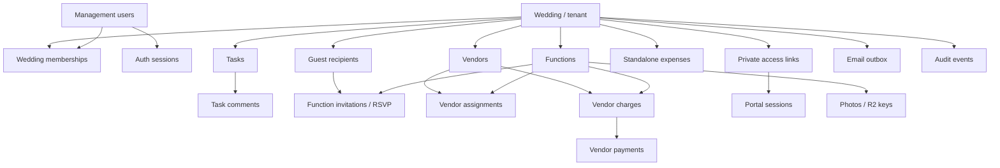

# MAKE MY EVENT

**14 November 2026 approved redesign:** Tasks retain assigneeUserId as required active human owner on writes and add independent optional vendorId. Legacy vendor-only/ownerless rows remain readable until reassigned. Mentions store field/userId/start/end ranges and derive notifications from assignment/new mention changes. Vendors add controlled color; vendorAssignments are historical only. expenses.modelVersion=2 stores real obligations with optional vendorId and status ACTIVE/VOID; expensePayments stores expenseId, expenseSource (expenses/vendorCharges), amountPaise, paidAt, method/notes, status POSTED/VOID and revision. Legacy paid expenses produce virtual settled payments only while not converted; never count them twice. Include expensePayments in wedding cascade. Migration is explicit, backed up, reconciled and tested before retained-data application. See [implementation plan](OPERATIONS_REDESIGN_PLAN.md).

**14 November 2026 product decision:** Vendors have no application access: no portal, private URLs, capability sessions, self-service task completion or vendor/photographer uploads. Administrators and organizers maintain vendor contacts, responsibilities, task status, charges and payments internally. Guest invitation access is unchanged. Google Places discovery remains deferred. Any earlier design exports or historical test notes describing vendor access are superseded.


**Phase 2 amendment — 13 November 2026:** Places discovery is deferred. Add `notifications`: weddingId, recipientUserId, actorUserId, taskId, commentId, createdAt, readAt (nullable). Unique `(weddingId,commentId,recipientUserId)` deduplicates mentions; index `(weddingId,recipientUserId,readAt,_id)` supports unread/history. Author/task labels are resolved only for authorized reads. Include notifications in tenant deletion. Tasks/vendors/financial entries gain positive integer revision for stale-edit protection; financial create requests use persisted idempotency keys. Historical Google requirements below are deferred reference, not a dependency. See [plan](PHASE_2_OPERATIONS_PLAN.md).

Implemented operations use tasks/taskComments/vendors/expenses/expensePayments and notifications; vendorCharges/vendorPayments remain legacy-compatible sources and vendorAssignments are historical only. Comments are revisioned and recipient/comment pairs deduplicate notifications. All management writes coordinate on the wedding document and revalidate membership transactionally. Vendor access has been removed. Legacy vendor accessLinks/portalSessions are inert and retained only for historical cleanup; they grant no access. Guest capability collection plans remain guest-only.

## Database Design Document — Version 1.0

**Status:** Implementation-ready design proposal; subject to security testing and architecture approval  
**Date:** 9 November 2026  
**Based on:** Make My Event PRD v1.0 and System Design & Architecture v1.0  
**Database:** MongoDB Atlas + Mongoose (TypeScript); Zod at API boundaries  
**Architecture:** Multi-tenant modular monolith, multiple wedding memberships per management account
**Initial sizing assumption:** Up to ~200 guest recipients per wedding; multiple independent wedding tenants

> **Design rule:** A **wedding** is the tenant. All management users in that wedding share operational data. Guests have revocable invitation links without accounts. Vendors have no application access. We store **actual expenses and payments**, never planned budgets. Photos are made visible after technical validation, **without human moderation**.

**12 November 2026 implementation amendment:** The schema/index changes below support multiple wedding memberships and admin-revealed/manual invitation codes. The guarded migration has been applied to the development database without removing business records. Other environments must apply it before accepting multi-wedding writes. Follow [the coordinated migration and rollback plan](MULTI_WEDDING_AND_INVITATION_CODES_PLAN.md#4-persistence-secret-lifetime-and-migration).

---

Implemented migration tooling stores a private BSON-preserving snapshot before applying changes. Wedding creation uses the canonical `idempotencyRecords` collection and a persisted 10-attempt/account/15-minute quota. Expired invitation ciphertext cleanup is bounded to 100 records per selected-wedding invitation-list read; no scheduled cleanup worker is claimed by this milestone.

## Account credential updates — 13 November 2026

`users.profileRevision` is an optional positive integer, legacy default 1, incremented on name/password updates for optimistic concurrency. `users.authSerial` is an optional monotonically increasing login coordination counter; successful logins write it while checking the verified password hash inside their session-creation transaction. Password changes write the same user document, set Argon2id passwordHash/passwordChangedAt/updatedAt, revoke prior authSessions and insert the new current session atomically. This serializes password changes against old-password logins. No new collections are added. Email identity and wedding memberships remain unchanged; no mailbox verification is implied. Profile DTOs expose only id/displayName/email/revision.

## 13 November 2026 — explicit full-tenant erasure

Administrator-confirmed wedding deletion uses the canonical collection inventory, not dynamically discovered names. The transaction serializes on the wedding document, revalidates its administrator and revision/title, deletes all weddingId-owned domain, authorization, email, scoped usage, replay and audit records, and finally removes the wedding document. No wedding audit row is reinserted after this explicit erasure. Global identities/sessions and unrelated weddings survive. `src/modules/weddings/wedding-deletion.ts` maintains the explicit cascade inventory; future tenant collections must join it. Photo-bearing deletion is refused until external R2 cleanup is implemented. Already sent email and historical backup copies are outside this application's active-data deletion transaction. This action never runs automatically during migration or verification against retained user data.

## 1. Purpose, scope, and decisions

This document specifies the MongoDB persistence design needed to implement the approved product: collections, fields, relationships, indexes, validation and consistency rules, tenant isolation, authentication/session records, RSVPs, expenses, email jobs, private photos, data lifecycles, and test cases.

**In scope:** Admin/organizer identities and roles; wedding setup and functions; tasks and comments; guest invitation/RVSP; vendor directory, assignments and charges; manual expense/payment tracking; Resend email outbox and daily reminders; R2 photo metadata and upload states; audit records, rate-limit counters, Google Places usage tracking.

**Out of scope:** Private organizer financial records, budget allocations, payment gateways, vendor bookings, guest authentication, Google OAuth, mandatory signup email verification, manually approved photo queues, public wedding profiles, and permanent Google Places listing caches.

### 1.1 Binding choices versus technical defaults

| Category                        | Decision                                                                                                         | Status                                       |
| ------------------------------- | ---------------------------------------------------------------------------------------------------------------- | -------------------------------------------- |
| Storage                         | MongoDB Atlas with Mongoose models and indexes                                                                   | Approved architecture                        |
| Isolation                       | `weddingId` is the canonical tenant key                                                                          | Approved architecture                        |
| Management members              | Multiple weddings per account; one lifetime membership row per `(weddingId,userId)` with per-wedding role/status | Updated product direction; migration pending |
| Management authentication       | Custom email/password, opaque DB-backed sessions                                                                 | Approved architecture                        |
| Guest access             | Unique private bearer links; no accounts                                                                         | Approved product rule                        |
| Finance                         | Standalone expenses + vendor charges/payments; no budgets                                                        | Approved product rule                        |
| Photography                     | Immediate publication after technical checks; no review queue                                                    | Approved product rule                        |
| Email                           | Resend, Mongo outbox, bounded immediate sending, daily Vercel Cron                                               | Approved architecture                        |
| RSVP deadline                   | Function default with optional per-invitation override; audited organizer correction                             | **Approved implementation decision**         |
| Function invitation eligibility | Explicit `ACTIVE` or `REVOKED`, separate from RSVP status                                                        | **Approved implementation decision**         |
| Reusable private links          | Token lookup hash plus separately encrypted recoverable secret where the existing URL must be resent             | **Approved implementation decision**         |
| Money                           | Integer minor units (`amountPaise`) in INR                                                                       | **Proposed technical default**               |
| Schedule                        | Small bounded schedule array embedded in each function                                                           | **Approved implementation decision**         |
| Theme/settings                  | Bounded configuration embedded in wedding                                                                        | **Proposed technical default**               |
| Delete policy                   | Soft-delete business entities, audit financial revisions                                                         | **Proposed technical default**               |

Approved decisions above are implementation contracts. Remaining technical defaults are chosen for simplicity and must be reviewed during the relevant phase without changing product scope.

## 2. Data-model principles

1. **Tenant-first data access.** Each independently queryable wedding-owned document has `weddingId: ObjectId`. All management reads/writes apply a server-derived `weddingId` filter; never trust the client's claimed tenant ID.
2. **References for unbounded relationships.** Guests, function invitations, tasks, comments, vendor assignments, payments, messages, and photos are separate collections. Do **not** embed an entire guest list or gallery inside a wedding document.
3. **Embed only bounded value objects.** Function schedule items, venue information, invitation theme overrides, settings, and a limited number of vendor phone numbers can be embedded.
4. **One source of truth.** RSVP status lives on the guest-function invitation. Monetary payments live on payment records. Dashboard totals are derived or explicitly rebuilt, never independently edited by clients.
5. **MongoDB transactions where invariants span records.** Most individual-document edits are atomic. Use a transaction or a conditional atomic-update pattern for membership redemption, charging/payment revisions, and operations creating several related records.
6. **Time is unambiguous.** Store event instants as UTC BSON dates; store the wedding's IANA time zone (default suggestion: `Asia/Kolkata`) for display and reminder scheduling. Do not store formatted local timestamps as the source of truth.
7. **Minor-unit currency.** Keep all INR values as validated whole-number paise; no floating-point rupee math. Establish hard caps below JavaScript's safe integer range.
8. **No external secrets in documents.** Never store plaintext passwords, active private-link tokens, session tokens, R2 secrets, or Resend credentials.
9. **Explicit retention and revocation.** Expired sessions are rejected at query time. TTL indexes are for eventual cleanup, not authorization decisions.
10. **Operational simplicity.** Prefer indexes supporting actual page/API queries; avoid speculative replicas, denormalized analytics, or unnecessary caches at MVP scale.

### 2.1 Identifier and field conventions

- Mongo primary key: `_id: ObjectId` (API presents a safe string representation).
- Primary tenant reference: `weddingId: ObjectId`.
- Cross-collection references: `<entity>Id: ObjectId` (for example `guestId`, `functionId`).
- Common metadata: `createdAt`, `updatedAt`, `createdByUserId?`, `updatedByUserId?`, `deletedAt?`.
- Enum values: consistent uppercase strings, e.g. `ACTIVE`, `REVOKED`, `PENDING`, `ACCEPTED`.
- Public invite access never uses sequential identifiers as a credential.
- Arrays of identifiers are not accepted as proof of permission; relationship records are looked up server-side.

## 3. Conceptual relationship map



**Cardinality overview:** Wedding 1:N functions, memberships, guests, vendors, tasks, expenses, photos, outbox rows; user 0:N wedding memberships, with one row per wedding/user pair; guest 1:N function invitations; function 1:N function invitations, tasks and photos; vendor 1:N assignments and charges; charge 1:N payments; access link 1:N short-lived portal sessions. Photographers may be internal vendor records but have no upload or application capability.

## 4. Collection inventory

| Collection            | Kind          | Primary responsibility                                                                        |
| --------------------- | ------------- | --------------------------------------------------------------------------------------------- |
| `users`               | Identity      | Email/password management accounts                                                            |
| `authSessions`        | Security      | Opaque management login sessions                                                              |
| `passwordResetTokens` | Security      | One-use password recovery links                                                               |
| `weddings`            | Tenant        | Event profile, bounded config, reminder and theme settings                                    |
| `weddingMemberships`  | Authorization | Admin/organizer role in one wedding                                                           |
| `membershipInvites`   | Authorization | Recipient-bound single-use management code; manual or email delivery, controlled admin reveal |
| `functions`           | Domain        | Wedding functions, schedule and venue                                                         |
| `tasks`               | Domain        | Organizer/vendor work and Kanban state                                                        |
| `taskComments`        | Domain        | Collaboration and @mentions                                                                   |
| `notifications`       | Domain        | Recipient-only in-app task mentions, unread/read history                                       |
| `guests`              | Domain        | Guest/family-head contact and preferences                                                     |
| `functionInvitations` | Domain        | Recipient-to-function access, RSVP, headcount and deadline                                    |
| `vendors`             | Domain        | Internal vendor contacts and responsibilities                                                   |
| `vendorAssignments`   | Domain        | Historical vendor/function responsibility records (no writes)                                                          |
| `vendorCharges`       | Finance       | Agreed vendor financial obligations                                                           |
| `vendorPayments`      | Finance       | Actual payment records against a charge                                                       |
| `expenses` | Finance | Real obligations (modelVersion 2) plus preserved legacy paid expense rows |
| `expensePayments` | Finance | Scoped full/partial payments against expenses or legacy charges; correction history |
| `accessLinks`         | Security      | Revocable private guest capability links; legacy vendor rows inert                                               |
| `portalSessions`      | Security      | Limited-scope sessions after private-link exchange                                            |
| `photos`              | Media         | R2 object references and technical publication state                                          |
| `emailOutbox`         | Jobs          | Invitations/reminders, queue and provider status                                              |
| `emailWebhookEvents`  | Jobs          | Optional delivery-event idempotency journal                                                   |
| `rateLimitWindows`    | Operational   | Shared rate-limit counters across Vercel invocations                                          |
| `serviceUsage`        | Operational   | Email and Places quota counters                                                               |
| `idempotencyRecords`  | Operational   | De-duplicate critical mutation requests                                                       |
| `auditEvents`         | Audit         | Durable security and high-impact change trail                                                 |

**Collection count:** 25, including small operational/security collections. They are not 25 microservices. A smaller implementation can merge some lifecycle journals if their invariants remain enforced, but it should not merge unbounded guest, photo or payment records into wedding documents.

## 5. Core tenant and identity schemas

The field tables below show the minimum required persisted fields and important optional fields; application DTOs may expose fewer fields. Mongoose `timestamps` add `createdAt` and `updatedAt` to mutable models.

### 5.1 `users`

| Field                    | Type / constraints                            | Meaning                                          |
| ------------------------ | --------------------------------------------- | ------------------------------------------------ |
| `_id`                    | ObjectId                                      | Management account ID                            |
| `emailNormalized`        | string, lowercased, trimmed, required, unique | Login identifier; **not proof of ownership**     |
| `displayName`            | string, 1–120 chars                           | Visible management name                          |
| `passwordHash`           | string, Argon2id hash                         | No plaintext or reversible password              |
| `status`                 | `ACTIVE \| DISABLED`                          | Account access state                             |
| `passwordChangedAt`      | Date?                                         | Session invalidation/recovery support            |
| `emailVerifiedAt`        | Date? / null                                  | Optional future support; not required for signup |
| `createdAt`, `updatedAt` | Date                                          | Audit metadata                                   |

**Indexes:** unique `{ emailNormalized: 1 }`; `status` need not have a standalone index at MVP scale. Normalize email consistently before uniqueness checks. Do not auto-attach membership on email matching.

### 5.2 `authSessions`

| Field                           | Type / constraints | Meaning                                                   |
| ------------------------------- | ------------------ | --------------------------------------------------------- |
| `userId`                        | ObjectId, required | Authenticated management user                             |
| `tokenHash`                     | string, unique     | SHA-256/HMAC digest of 256-bit random opaque cookie token |
| `expiresAt`                     | Date, required     | Session expiry                                            |
| `revokedAt`                     | Date?              | Forced logout                                             |
| `createdAt`, `lastSeenAt`       | Date               | Lifecycle                                                 |
| `userAgentHash`, `ipPrefixHash` | strings?           | Minimized security diagnostics                            |

**Indexes:** unique `{ tokenHash: 1 }`; `{ userId: 1, revokedAt: 1 }`; TTL `{ expiresAt: 1 }` with `expireAfterSeconds: 0`.

**Invariant:** Every session request checks expiry, revocation and account status directly. TTL cleanup is delayed and cannot replace authorization checks.

Sessions identify the account; they do not persist a selected wedding or global role as authority. Each management request validates its explicit wedding ID against the matching active membership. Removing/demoting a member in one wedding does not revoke sessions used for another; password recovery/compromise, disable and logout remain separate account-level operations. Code acceptance rotates the current session, not every session belonging to the account.

### 5.3 `passwordResetTokens`

`userId`, `tokenHash` (unique), `expiresAt`, `usedAt?`, `createdAt`, `requestContext?` (minimal and sanitized). TTL on `expiresAt`. Password recovery is allowed without a general signup verification requirement, but recovery requires proving mailbox control through a short-lived reset link; generic request responses prevent account enumeration. Invalidate old sessions on a successful reset.

### 5.4 `weddings`

| Field                    | Type / constraints       | Meaning                                                |
| ------------------------ | ------------------------ | ------------------------------------------------------ |
| `_id`                    | ObjectId                 | **Tenant identifier**                                  |
| `title`, `coupleNames`   | strings / bounded object | Wedding presentation                                   |
| `tradition`              | controlled string        | Suggested theme/function options                       |
| `startsAt`, `endsAt`     | UTC Dates                | Overall timeline                                       |
| `timeZone`               | IANA time zone string    | Venue-local display and reminder logic                 |
| `coverPhotoId`           | ObjectId?                | Reference to private event image if used               |
| `invitationDesign`       | bounded object           | `templateId`, text overrides, image references         |
| `reminderSettings`       | bounded object           | `enabled`, `daysBeforeDeadline`, cooldown policy       |
| `emailSettings`          | bounded object           | sender display name, template settings; **no API key** |
| `photoSettings`          | bounded object           | max photos/size, permitted formats                     |
| `status`                 | `ACTIVE \| ARCHIVED`     | Workflow state                                         |
| `createdByUserId`        | ObjectId                 | Initial administrator                                  |
| `createdAt`, `updatedAt` | Date                     | Metadata                                               |

No hard-coded maximum of two administrators. Theme and settings are small bounded subdocuments. Avoid storing guest lists, media bytes, or payment arrays here.

### 5.5 `weddingMemberships`

| Field                    | Type / constraints   | Meaning                |
| ------------------------ | -------------------- | ---------------------- |
| `weddingId`              | ObjectId, required   | Tenant                 |
| `userId`                 | ObjectId, required   | Account                |
| `role`                   | `ADMIN \| ORGANIZER` | Permission level       |
| `status`                 | `ACTIVE \| REMOVED`  | Current membership     |
| `joinedAt`, `removedAt?` | Date                 | Membership history     |
| `invitedByUserId?`       | ObjectId             | Who authorized joining |

**Target indexes:** unique `{ weddingId: 1, userId: 1 }` (one lifetime row; rejoin reactivates it); non-unique `{ userId: 1, status: 1, weddingId: 1 }` for account wedding listing; `{ weddingId: 1, status: 1, role: 1 }` for scoped membership/last-admin checks. Remove the old partial unique `{userId:1}`/`one_active_wedding_per_user` restriction only in a coordinated deployment after implicit-tenant writers are stopped. Retain all existing records; rollback cannot simply recreate that index once multiple memberships exist.

**Invariants:** Only admins change roles or membership; never remove/demote the last active admin. Admin-count check and membership update must be serialized safely (for example within a transaction plus conditional guard on wedding's `adminCount`/`membershipVersion`, or equivalent membership mutation lock). A simple `countDocuments()` followed by a delete is not concurrency-safe.

### 5.6 `membershipInvites`

`weddingId`, `role`, `codeVerifier` (unique keyed verifier), `invitedByUserId`, `intendedEmailNormalized` (required recipient-account binding in both delivery modes, never sufficient proof alone), `deliveryMethod: MANUAL|EMAIL`, `encryptedCode?` (AES-256-GCM ciphertext, nonce, tag and external key version; retained throughout the active invitation lifetime), `expiresAt`, `consumedAt?`, `revokedAt?`, `consumedByUserId?`, `createdAt`. Email provider acceptance does not delete ciphertext. Clear it on consume/revoke/reissue; deny expired use immediately and remove expired ciphertext through bounded cleanup. Never store plaintext codes in outbox/logs. Reissue invalidates the previous unused code only within the same wedding/recipient.

**Indexes:** unique `{ codeVerifier: 1 }`; `{ weddingId: 1, consumedAt: 1 }`; TTL `{ expiresAt: 1 }` after an appropriate audit retention decision.

**Join flow:** authenticate or create an account, enter the manually shared or emailed single-use code, match the intended account email and atomically consume the invitation plus create/reactivate its wedding/account pair. Memberships in other weddings are allowed; an already-active target pair returns ALREADY_A_MEMBER without consuming the code or changing its role. Never infer joining permission solely from an unverified email.

Team lifecycle metadata: memberships have a numeric `revision` (legacy default 1); rejoining reactivates the existing pair and increments its revision. Wedding `membershipVersion` serializes authorization/membership mutations, and account `membershipVersion` may serialize concurrent account membership operations without prohibiting different weddings. Unique pair indexing prevents duplicate joins. Revocation is per membership rather than global session invalidation. Maintain each wedding's `adminCount` within its serialized membership transaction, never from client input.

Invitations also store `creationKey`/`requestHash`, `failedAttempts`, `emailStatus` and optional revocation actor/reason. Manual mode creates no outbox row and uses NOT_SENT/Email not requested rather than a failure. Scoped idempotency and `(weddingId,createdAt)` listing indexes remain. The external `INVITATION_CODE_SECRET` remains 32 decoded bytes with versioned key derivation; preserve existing compatible keys and verifiers. Migrate recoverable encryptedDeliveryCode objects to encryptedCode without changing IDs/expiry; old delivered records whose ciphertext was already removed need an explicit replacement. Never reconstruct a code from a verifier or silently regenerate during migration. Reveal is admin-only, audited without secret values, rate-limited and no-store; it is the narrow exception to secret-free ordinary DTOs. Custom messages remain bounded plain text and sender security instructions remain fixed.

## 6. Wedding operations schemas

### 6.1 `functions`

| Field                               | Type / constraints                                      | Meaning                                                                                                                |
| ----------------------------------- | ------------------------------------------------------- | ---------------------------------------------------------------------------------------------------------------------- |
| `weddingId`                         | ObjectId, required                                      | Tenant                                                                                                                 |
| `name`, `description?`              | bounded strings                                         | Event identity                                                                                                         |
| `color`                             | `forest \| copper \| marigold \| rose \| plum \| slate` | Required organizer-selected function card accent on creation/edit; legacy colorless records display copper until saved |
| `startsAt`, `endsAt?`               | UTC Dates                                               | Function times                                                                                                         |
| `venue`                             | embedded object                                         | Name, address, city, state, postal code?, directions notes                                                             |
| `venue.latitude`, `venue.longitude` | numbers?                                                | `-90..90`, `-180..180` respectively                                                                                    |
| `venue.mapUrl?`                     | URL                                                     | Optional directions link                                                                                               |
| `scheduleItems`                     | bounded array                                           | `{ _id, title, startsAt, endsAt?, note? }`                                                                             |
| `dressCode?`, `guestInstructions?`  | bounded strings                                         | Guest-facing details                                                                                                   |
| `rsvpDeadlineAt?`                   | Date                                                    | Default deadline for invitations                                                                                       |
| `youtubeUrl?`                       | safe validated URL                                      | Optional stream/embed                                                                                                  |
| `sortOrder`                         | integer                                                 | Display ordering                                                                                                       |
| `status`                            | `ACTIVE \| CANCELLED \| ARCHIVED`                       | Function lifecycle                                                                                                     |
| `deletedAt?`                        | Date                                                    | Soft-delete if necessary                                                                                               |

**Indexes:** `{ weddingId: 1, startsAt: 1 }`; `{ weddingId: 1, status: 1, sortOrder: 1 }`. Schedule item count cap proposed: 50 per function. Do not persist vendor/Google Places search-result coordinates as independent permanent Google data unless permitted; these venue fields are organizer-provided event data.

### 6.2 `tasks`

`weddingId`, optional `functionId`, bounded `title` (160)/`description` (4000), required active `assigneeUserId` on new/edited rows, compatibility `assigneeType: USER`, `assigneeVendorId: null`, independent optional `vendorId`, `mentions[]: {userId,field:title|description,start,end}` (bounded UTF-16 text ranges), status TODO/IN_PROGRESS/COMPLETED, priority LOW/NORMAL/HIGH, dueAt/completedAt, revision, creator, deletedAt and timestamps.

All references are same-wedding validated. Owner must be an active manager. Retain an unchanged archived function or existing inactive vendor reference; new links require active records. Legacy ownerless/vendor-only documents are not rewritten or guessed: DTOs show Needs an owner and optional historical vendor context. Mutations require a UUID creationKey, persisted through scoped idempotencyRecords; revision guards edits. Task and new assignment/mention notifications share the wedding-locked transaction.

Indexes include `{weddingId:1,_id:-1}` and `{weddingId:1,deletedAt:1,status:1,assigneeUserId:1,_id:-1}`. Filters and status counts run before pagination.

### 6.3 `taskComments`

`weddingId`, `taskId`, `authorUserId`, `body` (bounded plain/sanitized text), `mentionedUserIds[]` (bounded ObjectId array), optional `mentionRanges[]: {userId,start,end}` for inline editing, `createdAt`, `updatedAt`, `deletedAt?`. Guest comments are not part of v1. Index `{ weddingId: 1, taskId: 1, createdAt: 1 }`. Verify that task and mentioned users are same-wedding records before writing.

### 6.4 `notifications`

Recipient-owned wedding rows contain actorUserId, recipientUserId, taskId, optional commentId, kind ASSIGNED/TASK_MENTION/ASSIGNED_MENTION (legacy comment mention rows remain valid), targetType TASK for task events, eventKey `task:<taskId>:<revision>`, createdAt/readAt and revision. New task events have null commentId. Unique partial `{weddingId,eventKey,recipientUserId}` covers string event keys; unique partial `{weddingId,commentId,recipientUserId}` covers ObjectId comments. Startup installs the replacement comment constraint before retiring its old all-row counterpart, preserving comment deduplication while allowing multiple task events. No data is deleted by that index transition. Actor/target previews are resolved only for scoped, available targets.

## 7. Guest invitation and RSVP schemas

### 7.1 `guests`

| Field                    | Type / constraints   | Meaning                                           |
| ------------------------ | -------------------- | ------------------------------------------------- |
| `weddingId`              | ObjectId             | Tenant                                            |
| `displayName`            | string               | Guest or family-head recipient                    |
| `emailNormalized?`       | email string         | Needed for email delivery, **optional otherwise** |
| `phone?`                 | optional string      | Informational; not an auth mechanism              |
| `personalMessage?`       | bounded string       | Invitation greeting                               |
| `emailOptOutAt?`         | Date                 | Stop optional reminders                           |
| `status`                 | `ACTIVE \| DISABLED` | Invitation eligibility                            |
| `createdByUserId`        | ObjectId             | Organizer source                                  |
| `createdAt`, `updatedAt` | Date                 | Metadata                                          |

**Indexes:** `{ weddingId: 1, displayName: 1 }`; `{ weddingId: 1, emailNormalized: 1 }` **nonunique**, because two invitation recipients can share a mailbox. Guest records have no password, login account, or separately enumerated family members.

### 7.2 `functionInvitations` (source of truth for RSVP)

| Field                    | Type / constraints                    | Meaning                                                                     |
| ------------------------ | ------------------------------------- | --------------------------------------------------------------------------- |
| `weddingId`              | ObjectId                              | Tenant                                                                      |
| `guestId`                | ObjectId                              | Recipient                                                                   |
| `functionId`             | ObjectId                              | Authorized function                                                         |
| `status`                 | `PENDING \| ACCEPTED \| DECLINED`     | RSVP state                                                                  |
| `eligibilityStatus`      | `ACTIVE \| REVOKED`, default `ACTIVE` | Whether this guest may access this function; independent of historical RSVP |
| `revokedAt?`             | Date                                  | When function eligibility was revoked                                       |
| `attendeeCount`          | integer, default 0                    | `0` when PENDING/DECLINED; `1..maxAttendees` when ACCEPTED                  |
| `maxAttendees`           | positive integer                      | Private organizer-set maximum                                               |
| `deadlineOverrideAt?`    | Date                                  | Optional override of function RSVP deadline                                 |
| `uploadAllowed`          | boolean                               | Optional per-invitation photo upload permission                             |
| `respondedAt?`           | Date                                  | Last RSVP response                                                          |
| `revision`               | nonnegative integer                   | Conditional update / optimistic concurrency                                 |
| `createdAt`, `updatedAt` | Date                                  | Metadata                                                                    |

**Indexes:** unique `{ weddingId: 1, guestId: 1, functionId: 1 }`; `{ weddingId: 1, functionId: 1, eligibilityStatus: 1, status: 1 }`; `{ weddingId: 1, guestId: 1, eligibilityStatus: 1 }`.

**Rules:** Guests can submit only through a valid guest capability and an `ACTIVE` function invitation belonging to that guest. Compute `deadline = deadlineOverrideAt ?? function.rsvpDeadlineAt` on the server; reject late guest edits. Admins/organizers can correct a locked RSVP after deadline with an audit event. RSVP form and reminder queries **must read this collection**, not a copied `guest.rsvp` field. Accepted headcount is an integer from 1 through `maxAttendees`. Declined and pending headcount is 0. Guests who decline keep eligible viewing/photo/livestream access unless eligibility is explicitly revoked.

### 7.3 RSVP consistency and aggregation

- Per-function current recipient counts: filter `eligibilityStatus: ACTIVE`, then aggregate by `functionId` and RSVP `status`. Historical reports may include revoked records when explicitly requested by an authorized manager.
- Confirmed attendees: sum of `attendeeCount` for `ACCEPTED` invitations.
- Show `invitedRecipients` and `confirmedPeople` separately; they are not interchangeable.
- Use atomic `findOneAndUpdate({ _id, guestId, weddingId, eligibilityStatus: 'ACTIVE', revision, ... })` with update-and-increment to avoid lost concurrent RSVP edits; check deadline and token scope inside the server path.
- Sending a reminder must **recheck** the current invitation state immediately before claiming/sending, so a newly accepted RSVP is not emailed accidentally.

### 7.4 Example invitation document

```json
{
  "_id": "ObjectId(...)",
  "weddingId": "ObjectId(...)",
  "guestId": "ObjectId(...)",
  "functionId": "ObjectId(...)",
  "status": "ACCEPTED",
  "eligibilityStatus": "ACTIVE",
  "attendeeCount": 3,
  "maxAttendees": 5,
  "deadlineOverrideAt": null,
  "uploadAllowed": true,
  "respondedAt": "2026-12-08T10:30:00.000Z",
  "revision": 2
}
```

`ObjectId(...)` strings above illustrate schema types; the example is not valid raw Mongo Extended JSON.

## 8. Vendor and finance schemas

### 8.1 `vendors`

`weddingId`, `name`, `category`, `phones[]` (1..5), `internalNotes`, `color: forest|copper|marigold|rose|plum|slate`, status ACTIVE/INACTIVE, creator, revision and timestamps. Color is required for new/edited vendors; missing legacy color renders neutral. Legacy email/place fields are preserved as history but are not new form/API inputs. Discovery is deferred. No vendor capabilities/accounts.

### 8.2 `vendorAssignments` — historical only

Retain existing wedding/vendor/function responsibility records and their unique index/cascade cleanup. No new assignment UI, route or service is exposed. Optional task vendorId replaces the operational need to assign a function to a vendor.

### 8.3 `vendorCharges` — legacy compatibility source

| Field                                 | Type / constraints    | Meaning                                              |
| ------------------------------------- | --------------------- | ---------------------------------------------------- |
| `weddingId`                           | ObjectId              | Tenant                                               |
| `vendorId`                            | ObjectId              | Which vendor                                         |
| `functionId?`                         | ObjectId              | Function to which agreed amount applies, if relevant |
| `description`                         | string                | Nature of charge                                     |
| `amountPaise`                         | safe positive integer | Agreed amount, **not yet necessarily paid**          |
| `currency`                            | `INR`                 | v1 currency                                          |
| `status`                              | `ACTIVE \| VOID`      | Active obligation or cancelled/reversed entry        |
| `createdByUserId`, `updatedByUserId?` | ObjectId              | Record of change                                     |
| `createdAt`, `updatedAt`              | Date                  | Metadata                                             |

**Indexes:** `{ weddingId: 1, vendorId: 1, status: 1 }`; `{ weddingId: 1, functionId: 1, status: 1 }`. Charge is not included in **actual spent** until payments have been recorded.

### 8.4 `vendorPayments` — legacy compatibility source

`weddingId`, `vendorId`, `chargeId`, `amountPaise` (safe positive integer), `paidAt` (UTC Date), `paymentMethod?` (e.g. CASH/UPI/BANK/OTHER, informational only), `reference?`, `notes?`, `status: POSTED|VOID`, `createdByUserId`, `voidedByUserId?`, `voidReason?`, `createdAt`, `updatedAt`, `idempotencyKey?`.

**Indexes:** `{ weddingId: 1, chargeId: 1, status: 1, paidAt: 1 }`; `{ weddingId: 1, vendorId: 1, status: 1 }`; unique partial `{ weddingId: 1, idempotencyKey: 1 }` for present idempotency keys.

**Invariants:** Payment, vendor and charge must all belong to the same wedding, and payment's vendor must match the charge vendor. A POSTED payment must be positive. A charge with POSTED payments cannot be voided or reduced below the posted total without first correcting/voiding the associated payments. If enforcing no overpayment, compute existing POSTED sum and atomically/transactionally prevent total paid exceeding charge `amountPaise`. Never simply subtract from a cached balance without concurrency protection. Editing or deleting an existing payment should use **void + replacement with audit**, not silently rewrite history.

### 8.5 `expenses` and `expensePayments`

New expenses use `modelVersion:2`, weddingId, optional vendorId, description/category/notes, integer positive amountPaise (at most 10,000,000,000), currency INR, status ACTIVE/VOID, revision, creator, timestamps and correction metadata. They represent obligations, not paid money. Legacy rows without modelVersion 2 retain their POSTED/VOID paid-expense meaning.

`expensePayments` stores weddingId, expenseId, expenseSource (`expenses` or unmigrated `vendorCharges`), server-derived optional vendorId, amountPaise, currency INR, paidAt, paymentMethod CASH/UPI/BANK/OTHER, notes, status POSTED/VOID, revision, creator/timestamps and correction metadata. Payment reference, source and tenant must match an active cost. Date conversion includes the wedding-time-zone precondition. Index `{weddingId:1,expenseSource:1,expenseId:1,status:1}` supports serialized balance checks; `{weddingId:1,_id:-1}` supports tenant inventory. Add this collection to permanent wedding deletion and isolation fixtures.

### 8.6 Financial definitions and legacy compatibility

Actual paid sums POSTED expensePayments + unmigrated POSTED vendorPayments + unmigrated legacy POSTED expenses once. Outstanding sums remaining amounts of active v2 expenses and unmigrated active vendorCharges. Legacy paid expenses project as settled costs plus virtual payment rows and contribute zero outstanding. Ledger cursors include source plus ID so equal IDs in different collections never collide. Monetary corrections retain original rows, actors and reasons.

Optional `scripts/migrate-finance-v2.mjs` defaults to selected-wedding dry run. Apply requires exact current title/revision and a new BSON backup directory. A coordinationVersion precondition rejects changes after backup. Within the wedding lock it creates deterministic v2 target IDs, preserves legacy source documents with migratedTo markers, retargets any new payments against legacy charges and reconciles paid/outstanding before commit. Legacy readers exclude migrated sources; old writers reject migrated references. No retained-data apply is part of normal UI deployment.

### 8.7 Recommended transaction boundaries

- Creating a vendor charge and its first payment in one user action: transaction if both must succeed together.
- Posting a payment while enforcing `paid <= charge`: transaction or a guarded atomic charge ledger update; retries safe with idempotency key.
- Voiding/replacing payment: transaction with audit event and valid recalculation.
- Expense edit after posting: prefer `VOID` followed by new entry and audit, avoiding historical ambiguity.

## 9. Guest private access and upload schemas

### 9.1 `accessLinks`

`weddingId`, `subjectType: GUEST`, `guestId`, `tokenHash` (unique), `encryptedSecret?`, `secretNonce?`, `secretAuthTag?`, `secretKeyVersion?`, `status: ACTIVE|REVOKED`, `createdAt`, `rotatedAt?`, `revokedAt?`, `expiresAt?`, `lastUsedAt?`, `createdByUserId`.

**Indexes:** unique `{ tokenHash: 1 }`; `{ weddingId: 1, subjectType: 1, status: 1 }`; unique partial active `{ weddingId: 1, guestId: 1, status: 1 }` for GUEST if policy is _one active link per recipient_. If the app supports several simultaneous links later, remove this limit deliberately.

Create cryptographically secure random secrets (at least 256 bits). Store a one-way `tokenHash` for lookup and validation. Where an existing private URL must be copied or resent, also store the same secret separately encrypted with AES-256-GCM. Store a unique nonce, authentication tag, and key version with the ciphertext; keep encryption keys outside MongoDB and source control. Authorized management copy actions and the email sender may decrypt only the currently active link. Outbox rows, logs, audit metadata, webhooks, analytics, and ordinary portal responses must never contain plaintext secrets or signed URLs. Rotate/revoke old links and portal sessions together. Key rotation requires a controlled re-encryption procedure; loss of an old key makes its encrypted secrets unrecoverable, so key backup and access control are operational requirements. A stolen link still grants its scoped capability until revocation, and authorized reveal must use `no-store` responses and audit without recording the secret.

### 9.2 `portalSessions`

`weddingId`, `linkId`, `subjectType`, `guestId`, `sessionTokenHash` (unique), `expiresAt`, `revokedAt?`, `createdAt`, `lastSeenAt`. TTL on `expiresAt` and immediate server expiry check. Opening `/invite/{secret}` verifies the link, creates a limited-scope cookie session, and redirects to a token-free URL. Revoking/rotating an `accessLinks` row must also invalidate sessions tied to that link (or enforce link status at every request).

**No account required:** A portal session is temporary capability-based access, not a guest account. It never provides organizer access.

### 9.3 `photos`

| Field                                                      | Type / constraints                                      | Meaning                                |
| ---------------------------------------------------------- | ------------------------------------------------------- | -------------------------------------- |
| `weddingId`, `functionId`                                  | ObjectId                                                | Scope of photo and gallery             |
| `uploaderType`                                             | `USER \| GUEST`                               | Upload principal kind                  |
| `uploaderUserId?`, `uploaderGuestId?` | ObjectId?                                               | Exactly one principal reference        |
| `storageKey`                                               | string, unique                                          | Private R2 object key (not public URL) |
| `mimeType`                                                 | allowlisted string                                      | Validated actual format                |
| `sizeBytes`, `width`, `height`                             | bounded integers                                        | Final stored media metadata            |
| `uploadState`                                              | `INITIATED \| VALIDATING \| READY \| FAILED \| DELETED` | Technical lifecycle only               |
| `visibleAt?`                                               | Date                                                    | When eligible users can first see it   |
| `deletedAt?`                                               | Date                                                    | Organizer removal marker               |
| `createdAt`, `updatedAt`                                   | Date                                                    | Metadata                               |

**Indexes:** `{ weddingId: 1, functionId: 1, uploadState: 1, visibleAt: -1 }`; `{ weddingId: 1, uploaderGuestId: 1, createdAt: -1 }`; unique `{ storageKey: 1 }`; `{ uploadState: 1, createdAt: 1 }` for abandoned-upload cleanup.

**No manual moderation state.** Valid upload transitions `INITIATED → VALIDATING → READY` only after R2 object presence, signature/MIME/size/dimension checks and authorization. READY photos are immediately eligible for the correct function gallery. Organizers may delete or reassign function. Guest gallery access is checked at read/download time. Raw objects remain private in R2; issue short-lived authorized GET URLs. Direct uploads use short-lived presigned PUT URLs and a post-upload finalize call; never expose private R2 API credentials.

**Storage keys:** `weddings/{weddingId}/functions/{functionId}/photos/{photoId}/{random}.webp`. Moving a photo between function galleries can change its **database functionId** without immediately copying the object; the storage key's initial folder is organizational only, **not an authorization source**.

## 10. Email, scheduled processing and operational schemas

### 10.1 `emailOutbox`

| Field                                            | Type / constraints                                                            | Meaning                                                                                                                    |
| ------------------------------------------------ | ----------------------------------------------------------------------------- | -------------------------------------------------------------------------------------------------------------------------- |
| `weddingId?`                                     | ObjectId / null                                                               | Owning tenant for invitations/reminders; null only for platform-level account messages                                     |
| `guestId?`, `functionId?`, `membershipInviteId?` | ObjectId                                                                      | Guest/function for guest communications; membership invitation reference for management email; absent for account recovery |
| `kind`                                           | `INVITATION \| RSVP_REMINDER \| ADMIN_INVITE \| PASSWORD_RESET`               | Email category                                                                                                             |
| `recipientEmail`                                 | validated string                                                              | Snapshot of destination at enqueue time                                                                                    |
| `templateData`                                   | bounded sanitized object                                                      | Names, function, deadline; no plaintext private token                                                                      |
| `status`                                         | `QUEUED \| PROCESSING \| SENT \| DELIVERED \| FAILED \| BOUNCED \| CANCELLED` | Local/provider state                                                                                                       |
| `sendAfter`                                      | Date                                                                          | Earliest job processing time                                                                                               |
| `leaseUntil?`, `claimedBy?`                      | Date/string                                                                   | Worker lease on processing                                                                                                 |
| `attemptCount`, `lastErrorCode?`                 | integer / safe code                                                           | Retry policy                                                                                                               |
| `providerMessageId?`                             | string                                                                        | Resend message reference                                                                                                   |
| `dedupeKey`                                      | string                                                                        | Deterministic business identity                                                                                            |
| `createdAt`, `updatedAt`, `sentAt?`              | Date                                                                          | Lifecycle                                                                                                                  |

**Indexes:** unique `{ dedupeKey: 1 }`; `{ status: 1, sendAfter: 1, leaseUntil: 1 }`; `{ weddingId: 1, createdAt: -1 }`; `{ providerMessageId: 1 }` sparse.

For `ADMIN_INVITE`, `weddingId` and `membershipInviteId` are mandatory; the sender decrypts the pending code only at dispatch and checks invitation validity. For `INVITATION` and `RSVP_REMINDER`, `weddingId` and `guestId` are mandatory; for `PASSWORD_RESET`, the job may be platform-scoped with no wedding and must never use guest-portal templates. Use **atomic lease claiming** (`findOneAndUpdate` with status, due date and expired lease guard). Batches have a hard limit. A sender rechecks guest existence, link validity, RSVP status and reminder eligibility before sending. Retry temporary errors with exponential backoff; mark permanent errors and bounce suppression. A deterministic reminder dedupe key can combine `guestId + functionId + scheduled-window`.

**Link contents:** Email workers retrieve and decrypt the current active guest link secret from `accessLinks` only at dispatch. `emailOutbox` stores a link reference, never the plaintext token or URL. The sender rechecks link status immediately before sending. This approved decision reuses the existing URL without rotating links on each reminder; see D-03.

### 10.2 `emailWebhookEvents`

`providerEventId` (unique), `providerMessageId`, `eventType`, `occurredAt`, `receivedAt`, `processedAt?`, `safeMetadata?`. Optional but recommended when using Resend delivery/bounce webhooks. Duplicate webhooks must be idempotent; the outbox status transitions must not regress from a terminal outcome to QUEUED.

### 10.3 `rateLimitWindows`

`keyHash` (unique together with `windowStart`), `windowStart`, `count`, `expiresAt`. Index unique `{ keyHash: 1, windowStart: 1 }`; TTL `{ expiresAt: 1 }`. Store hashed IP prefixes/link fingerprints where feasible. Enforce limits using atomic increments and explicit window-time checks; Vercel function memory is not shared between invocations. This protects login, invitation exchange, RSVP, upload, email, and Google Places endpoints.

### 10.4 `serviceUsage`

`service: RESEND|GOOGLE_PLACES|R2`, `scopeType: PLATFORM|WEDDING`, `weddingId?`, `periodType: DAY|MONTH`, `periodKey` (UTC `YYYY-MM-DD` or `YYYY-MM`), `requestCount`/`sendReserved`/`sendSucceeded`, `updatedAt`. Composite unique index across service/scope/period. Atomically reserve quota before costly API calls or email sends; reconcile failures safely. For Resend, enforce **platform-level** quota in addition to per-wedding quota, because the provider plan quota is shared.

### 10.5 `idempotencyRecords`

`weddingId?`, `principalHash`, `operation`, `key`, `requestHash`, `resultCode`, `resultRef?`, `createdAt`, `expiresAt`; unique `{ principalHash: 1, operation: 1, key: 1 }`; TTL on expiry. Store no private link token or sensitive response. Use for `POST /payments`, resend requests and other operations where retry can create duplicates. The result lookup must reject a reused key with a different request hash.

### 10.6 `auditEvents`

`weddingId?`, `actorType: USER|GUEST|SYSTEM`, `actorRef?`, `action`, `entityType`, `entityId?`, `occurredAt`, `requestId`, `beforeSummary?`, `afterSummary?`, `ipPrefixHash?`. Index `{ weddingId: 1, occurredAt: -1 }`; avoid storing secrets or full personal data snapshots. Record admin membership changes, access-link revocation, expense/payment voiding, photo deletion/retag, and email send requests. Audit records are not a replacement for provider/network application logs.

## 11. Google Places vendor discovery: persistence boundary

**Do not create a permanent `googlePlacesResults` cache.** Google Places API (New) results are fetched on demand with minimal field masks; display required Google and third-party attributions. Persist only the permitted `googlePlaceId` reference plus the wedding's **independently maintained vendor record** and any organizer-entered contact details. Vendor discovery does not imply booking, lead collection, or payment processing. Rate-limit and quota-track each call to avoid unexpected billing.

Google permits storing place IDs; most other Places content is subject to caching/storage restrictions and specific exceptions. Any coordinate/address copied from a Places result has different rules from **organizer-entered wedding venue coordinates**. Do not mix them casually. Refer to Google Places policies at implementation time.

## 12. Index register: minimum production set

| Collection            | Index                                                                         | Type / purpose                                                                          |
| --------------------- | ----------------------------------------------------------------------------- | --------------------------------------------------------------------------------------- |
| `users`               | `{ emailNormalized: 1 }`                                                      | Unique management login                                                                 |
| `authSessions`        | `{ tokenHash: 1 }`, `{ expiresAt: 1 }`                                        | Unique / TTL                                                                            |
| `weddingMemberships`  | unique `{weddingId:1,userId:1}`; non-unique `{userId:1,status:1,weddingId:1}` | One pair; multiple weddings allowed; legacy unique active-user index migration required |
| `weddingMemberships`  | `{ weddingId: 1, status: 1, role: 1 }`                                        | List managers, role checks                                                              |
| `membershipInvites`   | `{ codeVerifier: 1 }`, `{ expiresAt: 1 }`                                     | Unique / TTL                                                                            |
| `functions`           | `{ weddingId: 1, startsAt: 1 }`                                               | Upcoming functions                                                                      |
| `tasks`               | `{ weddingId: 1, status: 1, dueAt: 1 }`                                       | Dashboard and Kanban                                                                    |
| `taskComments`        | `{ weddingId: 1, taskId: 1, createdAt: 1 }`                                   | Task discussion                                                                         |
| `guests`              | `{ weddingId: 1, displayName: 1 }`                                            | Guest directory                                                                         |
| `functionInvitations` | `{ weddingId: 1, guestId: 1, functionId: 1 }`                                 | Unique RSVP per function                                                                |
| `functionInvitations` | `{ weddingId: 1, functionId: 1, eligibilityStatus: 1, status: 1 }`            | Current RSVP summary and pending filters                                                |
| `vendors`             | `{ weddingId: 1, category: 1, name: 1 }`                                      | Vendor directory                                                                        |
| `vendorAssignments`   | `{ weddingId: 1, vendorId: 1, functionId: 1 }`                                | Unique assignment                                                                       |
| `vendorCharges`       | `{ weddingId: 1, vendorId: 1, status: 1 }`                                    | Vendor balances                                                                         |
| `vendorPayments`      | `{ weddingId: 1, chargeId: 1, status: 1, paidAt: 1 }`                         | Charge paid total                                                                       |
| `expenses`            | `{ weddingId: 1, status: 1, paidAt: -1 }`                                     | Spend summaries                                                                         |
| `expensePayments` | `{ weddingId: 1, expenseSource: 1, expenseId: 1, status: 1 }`; `{ weddingId: 1, _id: -1 }` | Balance checks and tenant cursor |
| `accessLinks`         | `{ tokenHash: 1 }`                                                            | Unique private link lookup                                                              |
| `portalSessions`      | `{ sessionTokenHash: 1 }`, `{ expiresAt: 1 }`                                 | Unique / TTL                                                                            |
| `photos`              | `{ weddingId: 1, functionId: 1, uploadState: 1, visibleAt: -1 }`              | Gallery page                                                                            |
| `emailOutbox`         | `{ dedupeKey: 1 }`                                                            | Unique email job identity                                                               |
| `emailOutbox`         | `{ status: 1, sendAfter: 1, leaseUntil: 1 }`                                  | Worker claiming                                                                         |
| `rateLimitWindows`    | `{ keyHash: 1, windowStart: 1 }`, `{ expiresAt: 1 }`                          | Counter unique / TTL                                                                    |
| `serviceUsage`        | `{ service: 1, scopeType: 1, weddingId: 1, periodType: 1, periodKey: 1 }`     | Quota uniqueness                                                                        |
| `auditEvents`         | `{ weddingId: 1, occurredAt: -1 }`                                            | Investigation                                                                           |

**Index discipline:** Create indexes through checked-in migrations, not uncontrolled runtime `autoIndex` on production. TTL behavior is eventual; always check expiration in application logic. Before deploying a new unique index, validate existing duplicates. Avoid indexing optional/free-text fields without query evidence.

## 13. Query patterns and authorization examples

| Operation                 | Server-side query shape                                                                                                            | Authorization source                                |
| ------------------------- | ---------------------------------------------------------------------------------------------------------------------------------- | --------------------------------------------------- |
| List management functions | `functions.find({ weddingId: member.weddingId, status: 'ACTIVE' })`                                                                | Validated member session                            |
| Update a task             | `tasks.findOneAndUpdate({ _id: taskId, weddingId })`                                                                               | Member, then business rules                         |
| Guest portal functions    | `ACTIVE` function-invitation records filtered by `guestId` + `weddingId`, then joined to active functions                          | Valid portal session                                |
| Update RSVP               | `functionInvitations.findOneAndUpdate({ _id, weddingId, guestId, eligibilityStatus: 'ACTIVE', revision })`                         | Guest portal session + deadline                     |
| Internal vendor charges     | `vendorCharges.find({ weddingId, vendorId, status: 'ACTIVE' })`                                                                    | Validated management membership                               |
| Show vendor paid          | Aggregate `vendorPayments` by vendor/charge; check charge tenant                                                                   | Validated management membership                                 |
| Photo gallery             | `photos.find({ weddingId, functionId, uploadState: 'READY' })`                                                                     | Function invitation check before issuing media URLs |
| Email reminder candidates | `functionInvitations.find({ weddingId, functionId, eligibilityStatus: 'ACTIVE', status: 'PENDING' })` + guest valid email/settings | Worker authorized internally                        |

**Critical rule:** Never accept `weddingId` from a client as sufficient authority. An ID reference for a task, function, guest, payment, or photo is not proof of ownership. Validate the whole reference chain to the tenant.

## 14. Lifecycle and consistency workflows

### 14.1 Create wedding and assign first admin

Create `weddings` + first ADMIN membership atomically for any signed-in account, including accounts with other weddings. Persist and validate an account/operation-scoped creation idempotency key so retries cannot create duplicate weddings after removing the old unique active-user index. Different intentional creation keys may create different weddings. Start per-wedding membershipVersion/adminCount for serialized changes; retry transient transaction errors safely.

### 14.2 Accept organizer invitation

Validate the manually shared or emailed code against its keyed verifier and required intended account email; enforce expiry, revocation, attempt caps and limits. Atomically consume it and create/reactivate the target pair, allowing other active wedding memberships. Keep last-admin protection scoped to the affected wedding. A matching email alone is **not** sufficient permission. Admin reveal rechecks exact wedding membership/invitation state and decrypts only active recoverable codes; legacy missing ciphertext returns replacement guidance.

### 14.3 Create guest and function invitations

Create guest, then N `ACTIVE` function-invitation documents after verifying selected function IDs share `weddingId`. Prefer one transaction to avoid half-created invitations. Unique guest/function index stops accidental duplicates. Generate one active guest link scoped to the guest, not one link per function. Revoking one function invitation sets `eligibilityStatus: REVOKED` and `revokedAt` without changing its historical RSVP; all guest access and reminder queries exclude it.

### 14.4 Submit RSVP

Resolve private guest portal session; load matching `ACTIVE` `functionInvitations`; compute deadline and maximum; validate `status/attendeeCount`; atomically update with `revision` and active eligibility predicates. No change after deadline from guest portal; authorized organizer correction after a deadline records an audit event. No write to cached global attendee counts is required. Reporting aggregates are recalculated on demand at initial scale.

### 14.5 Post vendor payment

Resolve management wedding; verify charge and vendor both belong to wedding; validate amount and idempotency key. In transaction, prevent overpayment and create POSTED payment; add audit event. Recompute summary via aggregation. A duplicate retry must return the same payment result rather than creating another record.

### 14.6 Send invitation and reminder

Persist `emailOutbox` job with deterministic dedupe identity; process a bounded immediate batch when user requests sending. Daily Vercel Cron atomically claims due jobs and generates pending-only reminders, respecting active function eligibility, local deadlines, configured days-before offset, opt-outs, quotas, and send cooldowns. Before actual provider call, recheck eligibility and link validity. Resend provider acceptance sets `SENT`, never `DELIVERED` without provider confirmation; webhook messages can later set `DELIVERED`/`BOUNCED`. A sender crash after provider acceptance remains an at-least-once risk; provider idempotency keys must be stable across retries.

### 14.7 Upload and publish photo without approval

1. Guest/member is authorized for the target function; check upload quota.
2. Create `photos` record in INITIATED; issue short-lived R2 presigned PUT for that object.
3. Client uploads compressed photo directly to **private** R2 bucket.
4. Finalization verifies uploaded object's ownership, size, signature/MIME/dimensions and expected key.
5. Mark `photos.uploadState = READY` and `visibleAt = now`; eligible guests can immediately see it.
6. On failure, mark FAILED and clean up object. Organizers can soft-delete or retag; gallery read checks **current** functionId, not storage folder.

## 15. Retention, deletion and privacy policy

| Data                                | Proposed policy                                                                      | Reason                      |
| ----------------------------------- | ------------------------------------------------------------------------------------ | --------------------------- |
| Auth/portal sessions                | Expiry + TTL cleanup; revoke immediately                                             | Security                    |
| Membership join and recovery tokens | One-use, time-limited, TTL after expiration                                          | Security                    |
| Access links                        | Keep active until explicitly revoked/rotated; optional expiry                        | Post-wedding photo access   |
| RSVP and guest records              | Keep while wedding active/archived until organizer deletion or defined retention     | Event usefulness            |
| Email outbox                        | Keep status/history for a defined period; purge older payloads                       | Quota/debug vs PII          |
| Email webhooks                      | Short bounded retention                                                              | Idempotency and diagnostics |
| Photos                              | No auto-expiration in product rule; storage capacity and deletion policy still apply | Long-term memories          |
| Audit events                        | Retain security-critical change trail for defined period                             | Accountability              |
| Rate limit counters                 | TTL after window + grace                                                             | Low storage                 |
| Google Places results               | Do not persist listing/result cache                                                  | Platform compliance         |

**Deletion strategy:** A privacy/export or wedding deletion operation must enumerate related Mongo data, active sessions, private links, outbox jobs and R2 objects. Use a resumable deletion job for R2 (Mongo and R2 cannot share an atomic transaction). The product must not claim permanent unlimited storage on free tiers. Establish retention periods before real-user launch and document them in the privacy policy.

## 16. Validation boundaries and Mongoose guidance

- **Zod** validates API DTOs, query parameters, enums, numeric bounds, dates, URLs and field lengths before any service operation.
- **Mongoose** imposes stored-document shape, `required`, enum, integer constraints, immutable references where appropriate, and explicit indexes.
- **MongoDB unique indexes** are the final concurrent-write guard for unique email, active membership, guest-function invitation, dedupe keys and private token digests.
- **Service layer** checks cross-document business invariants (tenant/reference linkage, role transitions, deadlines, payments, photo eligibility, provider quota).
- Avoid `.lean()` documents as a reason to bypass authorization; access checks remain in services.
- `ObjectId` parsing must reject invalid IDs with controlled `400` responses; do not leak model-internal errors.
- Disable production `autoIndex`; apply index migrations deliberately with verification.
- Do not let a client update security or computed fields using raw `$set` or unrestricted object spread. Use explicit allowlists per endpoint.

### 16.1 Example TypeScript model shape (illustrative)

```ts
type Role = "ADMIN" | "ORGANIZER";

type FunctionInvitation = {
  weddingId: Types.ObjectId;
  guestId: Types.ObjectId;
  functionId: Types.ObjectId;
  status: "PENDING" | "ACCEPTED" | "DECLINED";
  eligibilityStatus: "ACTIVE" | "REVOKED";
  attendeeCount: number; // zero unless ACCEPTED
  maxAttendees: number; // private organizer setting
  deadlineOverrideAt?: Date;
  uploadAllowed: boolean;
  respondedAt?: Date;
  revision: number;
};

// Schema indexes:
// unique (weddingId, guestId, functionId)
// (weddingId, functionId, status) for RSVP dashboard/reminders
```

## 17. Test plan and data fixtures

### 17.1 Fixtures

- Wedding A and Wedding B, each with different management users, guests, vendors, functions and photo galleries.
- Wedding A: multiple admins and organizers, 4 functions, 200 invited guest recipients, 20 vendors, 500 tasks, partial payments, RSVP mix and R2-photo metadata.
- Unverified email user, valid/expired/used membership invites, revoked portal links, overlapping sessions.
- Guests with 1/2/5 function invitations and different attendee maxima, expired deadlines and declined RSVPs.
- Resend free-quota boundary, cron rerun, bounced email, duplicate provider webhook, provider timeout.
- Google Places quota exhausted, disabled billing, no results, malformed response, selected place ID.

### 17.2 Required automated tests

| Risk                        | Test                                                                                                                                                              |
| --------------------------- | ----------------------------------------------------------------------------------------------------------------------------------------------------------------- |
| Tenant isolation            | Wedding A member cannot read/update Wedding B's rows, even with known ObjectIds                                                                                   |
| Multiple memberships        | Concurrent joins to different weddings may both succeed; duplicate joins to the same wedding leave one membership row; removing access in one preserves the other |
| Last admin                  | Concurrent admin removals never leave zero admins                                                                                                                 |
| Unverified email            | Matching a claimed email never joins automatically; a valid recipient-bound admin code is required whether shared manually or emailed                             |
| Token revocation            | Link and existing portal sessions stop working after revocation                                                                                                   |
| Guest RSVP                  | No uninvited function access; count bound and deadline enforced in backend                                                                                        |
| Function revocation         | Revoked invitation retains historical RSVP but no longer grants function, photo, livestream or RSVP access and receives no reminder                               |
| RSVP concurrency            | Two updates with same revision cannot silently overwrite each other                                                                                               |
| Payment concurrency         | Repeated or parallel requests cannot duplicate payment or exceed agreed charge                                                                                    |
| Financial totals            | Standalone expenses + posted vendor payments counted once, voids excluded                                                                                         |
| Photo access                | Non-invitee cannot obtain private R2 GET for function gallery object                                                                                              |
| Immediate photo publication | Object only becomes READY after technical validation, never approval                                                                                              |
| Email outbox                | Two workers cannot claim the same live lease; stable provider idempotency key                                                                                     |
| Reminders                   | Accepted/declined/opted-out/expired/revoked guests excluded                                                                                                       |
| Quotas                      | No excess calls beyond configured per-wedding/platform Google/Resend limits                                                                                       |
| Index migration             | New unique indexes apply cleanly or fail with actionable diagnostics                                                                                              |
| Restore                     | Backup and restore recover consistent guest/payment/media references                                                                                              |

## 18. Six-phase implementation mapping

| Phase                | Collections introduced / hardened                                                                                                                              | Completion gate                                                             |
| -------------------- | -------------------------------------------------------------------------------------------------------------------------------------------------------------- | --------------------------------------------------------------------------- |
| **P1 — Foundation**  | `users`, `authSessions`, `passwordResetTokens`, `weddings`, `weddingMemberships`, `membershipInvites`, `functions`, baseline `rateLimitWindows`, `auditEvents` | Cross-tenant, auth and last-admin tests pass                                |
| **P2 — Operations**  | `tasks`, `taskComments`, `vendors`, `vendorAssignments`, `vendorCharges`, `vendorPayments`, `expenses`, `expensePayments`, `notifications` (vendor access removed; discovery deferred)            | Task assignment and expense consistency, management tenant isolation and notification privacy tests |
| **P3 — Guests/RSVP** | `guests`, `functionInvitations`, guest `accessLinks`, `portalSessions`, `idempotencyRecords`                                                                   | Revocation and deadline/limit tests pass                                    |
| **P4 — Email**       | `emailOutbox`, `emailWebhookEvents`, service quotas, reminder settings                                                                                         | No duplicate provider sends, pending-only reminder tests pass               |
| **P5 — Media**       | `photos`, R2 references, media quota counters                                                                                                                  | Upload-finish and private gallery access tests pass                         |
| **P6 — Production**  | Index migrations, audit retention, data cleanup, backups/restore, query reviews                                                                                | Release, privacy and operational gates passed                               |

## 19. Decision register and remaining implementation defaults

| ID                  | Decision                                   | Recommended resolution                                                                                                                       |
| ------------------- | ------------------------------------------ | -------------------------------------------------------------------------------------------------------------------------------------------- |
| **D-01 — approved** | RSVP deadline granularity                  | Function default with invitation-level override; audited organizer correction                                                                |
| **D-02 — approved** | Guest photo upload control                 | `uploadAllowed` per function invitation; organizers always manage photos                                                                     |
| **D-03 — approved** | Reuse guest link in later Resend reminders | AES-256-GCM encrypted active link secret with external versioned key; separate hash for lookup; never log or place plaintext in email outbox |
| **D-04**            | Admin changes under concurrency            | Wedding-level membership version/guard in transaction                                                                                        |
| **D-05**            | Money recording policy                     | Integer paise; prevent overpayment; void-and-replace corrections                                                                             |
| **D-06**            | Retention lengths                          | Document privacy policy and service limits before real launch                                                                                |
| **D-07**            | Photo quotas                               | Decide per-upload size, per-wedding cumulative storage, and formats after R2 load tests                                                      |
| **D-08**            | Email sending caps                         | Hard daily/monthly platform cap and per-wedding soft cap; show queue backlog                                                                 |

**Decision status:** D-01 through D-03 are approved. Embedded function schedules and independent function-invitation eligibility are also approved. Any default value for guest upload permission is set in the media phase. D-04's last-admin invariant is binding, while its concurrency mechanism must be chosen and tested in Phase 1. D-05's expense-only scope is binding; correction mechanics remain an implementation detail. D-06 through D-08 require configurable operational values and final approval before production.

## 20. References and design verification

The following authoritative documentation supports the operational constraints used above; verify specific plan limits and service terms again at deployment time.

- MongoDB — TTL indexes: https://www.mongodb.com/docs/current/core/index-ttl/ (expiration removal is eventually consistent, not immediate).
- MongoDB — Node.js driver transactions: https://www.mongodb.com/docs/drivers/node/current/crud/transactions/ (multi-document atomicity; transaction retry behavior).
- Cloudflare R2 — Presigned URLs: https://developers.cloudflare.com/r2/api/s3/presigned-urls/ (temporary GET/PUT access to private objects).
- Google Places API (New) — Policies and attributions: https://developers.google.com/maps/documentation/places/web-service/policies (place-ID storage and content caching restrictions).

---

**End of Database Design Document — Make My Event v1.0**

Deletion replay protection: creation idempotency rows become anonymous tombstones containing only their opaque key hash and deletion timestamp. Account, wedding and payload references are removed. This prevents an old creation retry from recreating an explicitly deleted wedding; a fresh creation key still permits a new wedding.

### Invitation delivery and deletion coordination — 13 November 2026

The `emailOutbox.status = PROCESSING` row is also the durable wedding-deletion reservation. Creation inserts it under the wedding lock; deletion checks it under the same lock. Only the sender’s final tenant update may release it by setting a terminal status. Stale PROCESSING reservations require outcome reconciliation; they must not be silently expired while a provider call can still begin.

### Invitation redemption session fencing — 13 November 2026

Redemption transactionally consumes the exact authenticated, active, unexpired current session before accepting the code or minting a replacement. Password changes and logout write that same row, so a paused request authenticated earlier receives 401 AUTH_REQUIRED after revocation; invitation/membership changes roll back and no replacement cookie is sent. If redemption commits first, a subsequent password change revokes its newly created session. Session rotation is single-use: parallel redemptions sharing one old cookie may require retry with the fresh session, while independently authenticated sessions can join separate weddings concurrently. Other legitimate sessions are not revoked by redemption itself.

## Operations refinement storage - 14 November 2026

The paid-expenses convenience operation adds no collection: insert a modelVersion 2 ACTIVE expenses row and one POSTED expensePayments row for the same amount in one wedding-locked, membership-validated transaction. Both use the same tenant and resolved optional vendor; operation idempotency key PAID_COST_CREATE prevents duplicate purchases on retry. Removal retains VOID records, reason, actor and revision; it is not physical deletion. Existing cascade inventory includes both collections. Notification badge reads count unread notifications by weddingId and recipientUserId with readAt null; no additional stored counter or delivery channel is introduced.
